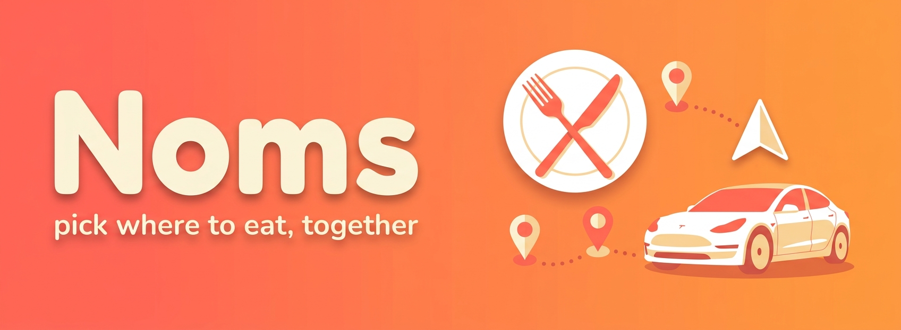

<p align="center">
  
</p>

<p align="center">
  <a href="https://github.com/johnpc/jpc-noms/actions/workflows/ci.yml"></a>
  
</p>

# Noms

**Pick where to eat, together.** Noms is a two-person app for deciding where to go out. Search
restaurants, save your favorites to a shared **rotation**, and start a **nom** — a collaborative
shortlist you and your partner build together. Either of you can add options; the other gets a push
notification the moment you do. When one of you marks a pick as **selected**, it sets the navigation
on your Tesla automatically.

Browse restaurants instantly — no account required. Sign in and pair with your partner to nominate
together.

## What makes it different

- 🍽️ **Noms are shared and collaborative.** A nom belongs to _both_ of you. Add a restaurant from
  either phone and it shows up live on the other.
- 🔔 **Real push notifications.** Your partner adds Joe's Pizza to tonight's nom → your phone buzzes.
- 🚗 **Winner routes to the car.** Mark a nom selected and Noms sends the restaurant's address to your
  Tesla's navigation (via Tessie) — no copy-paste, no "what's the address again?".
- 👫 **Pair in one scan.** Point one phone's camera at your partner's QR code and you're connected —
  both apps update instantly and buzz. (Email invite works too.)
- 🎲 **Can't decide? "Decide for us"** picks one of the nom's options at random — and still routes the
  winner to the car.

## Features

| Feature                                          | Status |
| ------------------------------------------------ | ------ |
| Guest-browsable restaurant search + photos       | ✅     |
| Save favorites to a rotation                     | ✅     |
| Partner pairing — **QR scan-to-connect** + email | ✅     |
| Collaborative noms (add / remove / select, live) | ✅     |
| 🎲 "Decide for us" — random pick from a nom      | ✅     |
| Re-open / delete a nom; unpair                   | ✅     |
| APNs push on partner activity + on connect       | ✅     |
| Tesla navigation on selection                    | ✅     |
| Dining stats & decision history                  | ✅     |
| Account management (password / delete)           | ✅     |
| Light / dark theme (Settings)                    | ✅     |

## Stack

Ionic 8 + React 19 + TypeScript (strict) + Vite + Capacitor (iOS), on AWS Amplify Gen2 (Cognito +
AppSync + DynamoDB). Restaurant data comes from the Google Places API; the Tesla hand-off runs through
a DynamoDB-stream Lambda calling the Tessie API. Architecture, quality gates, and CI descend from the
[stoop](https://github.com/johnpc/stoop) / [spork](https://github.com/johnpc/spork) reference apps.

## How it works

- **Restaurant data** comes from the **Google Places API**. A `searchGooglePlaces` /
  `getGooglePlace` / `getGooglePlaceImage` trio of Lambda resolvers proxies Places and caches every
  response in a `GoogleApiCache` DynamoDB table (keyed by a stable hash), so repeat lookups are free
  and the app never ships the API key to the client. Photos are hosted image URLs resolved on demand.
- **Pairing is one scan.** Your QR encodes your Cognito id + email; scanning your partner's creates a
  single multi-owner `Pairing` with both of you (no server round-trip). A Pairing-stream Lambda pushes
  "You're paired!" to both. Either can unpair.
- **A nom is shared, not copied.** The `Nom` model is multi-owner (`members` + `ownersDefinedIn`), so
  both partners read and write the _same_ row. Edits (add / remove / select / re-open / delete)
  propagate live over **AppSync subscriptions**, applied straight into the client cache (no refetch).
- **Push** rides a DynamoDB stream on the `Nom` table → a Lambda that notifies the _other_ partner via
  **APNs** (SNS) when an option is added or a nom is decided.
- **The Tesla hand-off** is a second consumer of that stream: when a nom is marked selected, a Lambda
  reads the winning place's address from the cache and calls the **Tessie** `share` command to set the
  car's navigation. Tessie credentials live in **AWS Secrets Manager**, never in code or plaintext env.
- **No AI generation** here — all content is real Google Places data + the two partners' own choices.

## Setup

```bash
git clone git@github.com:johnpc/jpc-noms.git
cd jpc-noms
npm install
cp .env.example .env      # add your Google Places + Tessie keys
AWS_PROFILE=personal npx ampx sandbox   # deploy a personal backend
npm run e2e-config        # pull amplify_outputs.json from the sandbox
npm run dev               # http://localhost:5173
```

## Fake backend (demo mode + CI)

```bash
npm run dev:fake          # the whole app on an in-browser fake backend — no AWS, no keys
npm run test:e2e:fake     # the full Gherkin suite against it (what CI runs on every PR)
```

`FAKE_BACKEND=1` aliases the Amplify SDK to `src/fake-backend/`: Cognito, AppSync models,
subscriptions and the Places/pairing/poke resolvers are re-implemented in ~400 lines over
`localStorage`, seeded with the same restaurants, favorite and noms as `amplify/seed`. Sign in as
`demo@noms.test` / `noms-demo` (sign-up and password-reset codes are `123456`). The page announces
which backend it is on via `<html data-backend="fake|amplify">`. App code is untouched — the swap is
three Vite aliases in `vite.config.ts`.

## Quality

Every commit passes the full gate (husky pre-commit + CI): no `any`, ≤100-line logic files, ≥80% test
coverage, CRAP ≤15, Prettier clean, Gherkin acceptance tests (Playwright + playwright-bdd) on **both**
the fake backend and an ephemeral Amplify sandbox, an explicit state-machine catalog
(`docs/state-machines.md`, gate-checked), and a green build. See `CLAUDE.md` for the working
agreement and `AGENTS.md` for the operating rules.

### No flaky tests

There is no such thing as a flaky test here. An intermittent failure is a race — in the harness or
the app — and it gets found and fixed. Nobody re-runs to green, adds a sleep, raises a timeout, skips a
scenario or sets `retries > 0`; `scripts/check-e2e-waits.mjs` refuses all of those. Steps wait on real
conditions (a locator, `html[data-auth]`, a URL), never on time.
